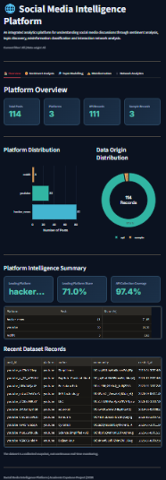
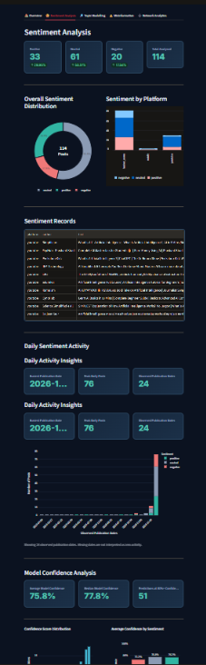
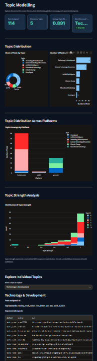
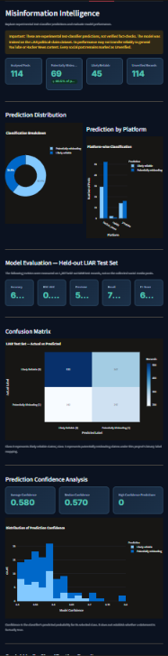
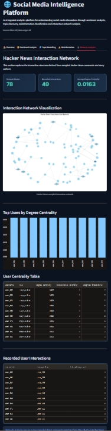

# Large-Scale Social Media Intelligence Platform

An end-to-end Data Science project that collects and analyses publicly accessible online discussions using Natural Language Processing, Machine Learning, and Graph Analytics. The platform transforms unstructured text into insights through sentiment analysis, topic discovery, experimental misinformation classification, and interaction network analysis.

## Project Overview

The platform integrates data from YouTube and Hacker News APIs, alongside sample Reddit records, into a unified dataset. It processes the collected content through analytical pipelines and presents the results in an interactive Streamlit dashboard.

## Key Features

### 1. Multi-Source Data Ingestion
- Integrated YouTube Data API v3 for collecting video-related discussions.
- Used the official Hacker News Firebase API to collect stories and selected comments.
- Included sample Reddit records while API approval remains pending.
- Combined the collected records into a unified dataset.

### 2. Text Preprocessing
- Cleaned and standardized unstructured text.
- Handled missing values and duplicate records.
- Prepared structured datasets for downstream analysis.

### 3. Sentiment Analysis
- Applied a pretrained CardiffNLP RoBERTa sentiment model.
- Classified posts into positive, neutral, and negative categories.
- Generated sentiment confidence scores.
- Analysed sentiment distributions across platforms.

### 4. Topic Modelling
- Implemented TF-IDF vectorization and Non-negative Matrix Factorization (NMF).
- Identified five discussion topics.
- Assigned topic IDs and extracted representative keywords.
- Handled records with no meaningful topic contribution as unassigned.

### 5. Misinformation Classification
- Prepared a labelled dataset using the LIAR dataset.
- Developed a TF-IDF and Logistic Regression classification pipeline.
- Evaluated the classifier using held-out test data.
- Generated experimental predictions for social media posts.

### 6. Graph Analytics
- Built a directed user-interaction graph using NetworkX.
- Analysed sampled Hacker News interactions.
- Calculated user centrality measures.
- Exported graph data and visualizations.

### 7. Interactive Analytics Dashboard
Developed a Streamlit and Plotly dashboard with five sections:

- Overview
- Sentiment Analysis
- Topic Modelling
- Misinformation Analysis
- Network Analytics

## Project Results

| Metric | Result |
|---|---:|
| Unified records | 114 |
| YouTube records | 30 |
| Hacker News records | 81 |
| Reddit sample records | 3 |
| Topic categories | 5 |
| Unassigned topic records | 3 |
| Misinformation classifier accuracy | 60.62% |
| Hacker News graph nodes | 78 |
| Hacker News graph edges | 49 |

## 📸 Dashboard Screenshots

Explore the five analytical modules of the interactive Streamlit dashboard.

### 1. Dashboard Overview


### 2. Sentiment Analysis


### 3. Topic Modelling


### 4. Misinformation Analysis


### 5. Network Analytics


*Note: Screenshots represent analytical results from the collected project dataset.*


## Technology Stack

| Area | Technologies |
|---|---|
| Programming | Python |
| Data Processing | Pandas, NumPy |
| NLP | Hugging Face Transformers, RoBERTa |
| Sentiment Analysis | CardiffNLP |
| Topic Modelling | TF-IDF, NMF |
| Machine Learning | Scikit-learn, Logistic Regression |
| Graph Analytics | NetworkX |
| Visualization | Streamlit, Plotly, Matplotlib |
| API Integration | YouTube Data API, Hacker News Firebase API |
| Version Control | Git, GitHub |

## Project Structure

```text
social-media-intelligence-platform/
├── data/
│   ├── raw/
│   ├── processed/
│   └── sample/
├── dashboards/
│   └── app.py
├── reports/
│   ├── evaluation/
│   └── figures/
├── src/
│   ├── ingestion/
│   ├── preprocessing/
│   ├── sentiment/
│   ├── topic_modeling/
│   ├── misinformation/
│   └── graph_analytics/
├── models/
├── .env.example
├── .gitignore
├── requirements.txt
└── README.md
```

## Installation and Setup

### 1. Clone the repository

```bash
git clone https://github.com/Harshalspage/social-media-intelligence-platform.git
cd social-media-intelligence-platform
```

### Optional: Transformer-based Sentiment Inference

The dashboard uses precomputed sentiment results. To rerun transformer-based sentiment inference, install the optional dependencies:

```bash
pip install -r requirements-inference.txt
```

Note: PyTorch installation compatibility depends on your operating system and environment.

### 2. Create and activate a virtual environment

```bash
python -m venv venv
source venv/bin/activate
```

### 3. Install dependencies

```bash
pip install -r requirements.txt
```

### 4. Configure environment variables

Create a `.env` file in the project root and configure the required API credentials using `.env.example` as a reference.

Never commit API keys or other secrets.

### 5. Run the dashboard

```bash
python -m streamlit run dashboards/app.py
```

Open the local URL displayed in the terminal.


## Model Evaluation

The misinformation classification model was trained using the LIAR dataset with a TF-IDF and Logistic Regression pipeline.

### Held-out Test Results

| Metric | Score |
|---|---:|
| Accuracy | 60.62% |
| ROC-AUC | 0.6286 |
| Precision | 0.5436 |
| Recall | 0.7834 |
| F1-score | 0.6418 |

The model is experimental. Since it was trained on political claims from the LIAR dataset and applied to general social media posts, domain differences may affect its predictions.

Predictions should not be treated as verified fact-checks. All social-post predictions remain marked as Unverified.


## Limitations

- Reddit API approval is pending; the current unified dataset contains three sample Reddit records.
- The dataset represents a collected snapshot rather than continuous real-time monitoring.
- Sentiment scores represent model confidence, not verified sentiment accuracy.
- Topic labels are interpretive and provisional.
- Misinformation predictions are experimental and should not be treated as factual verification.
- Network analytics covers sampled Hacker News interactions rather than the complete platform network.
- The RoBERTa sentiment model requires its additional Transformers and PyTorch dependencies to rerun inference.


## Responsible Data Use

- Data collection is subject to platform API terms, privacy requirements and applicable usage restrictions.
- Reddit records in the current dataset are sample records, not Reddit API-collected content.
- The LIAR dataset is used for research-oriented model development. Its source data and derived training splits are excluded from the repository because redistribution permissions have not been established.
- Public network analytics use anonymized user identifiers.
- No API credentials, private original datasets or sensitive information should be committed to this repository.
- Misinformation predictions are experimental and must not be interpreted as verified factual claims.


## Project Information

- **Project Type:** Data Science Capstone Project
- **Development Start:** 20 October 2026
- **Submission Deadline:** 20 November 2026
- **Status:** Implemented prototype

## Author

**Harshal Somnath Shirsat**

GitHub: https://github.com/Harshalspage/social-media-intelligence-platform
